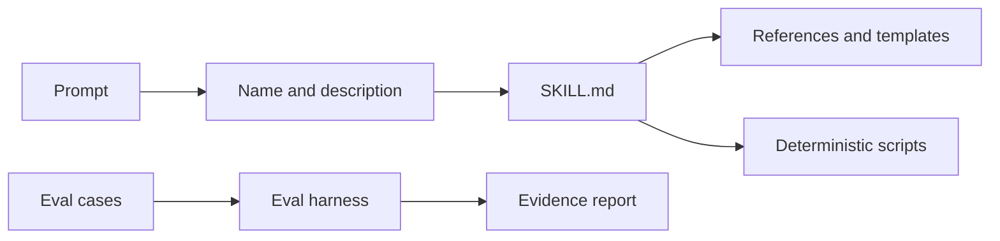

# Architecture

AIWorkbench is a portable catalog. Each `skills/<name>/SKILL.md` is a discovery and instruction entrypoint. Domain resources load on demand. Deterministic scripts validate structure; behavioral evals remain separate.

Every installed skill and exported ZIP is self-contained. Files in the repository's `shared/` directory govern catalog maintenance; skill instructions must not link to them because installers copy a single skill folder.

Skills 1.2.0 keep the entrypoint, conditional practice guidance, a worked example and a domain handoff template. Product UI metadata is optional. Catalog maintenance uses a real YAML parser and the public metadata fields; it does not require uniform headings or a verifier in every skill.

Evaluation v2 separates selection prompts from outcome cases. Outcome fixtures are copied into distinct baseline/candidate workspaces, while known controls and graders stay outside those copies. Candidate function imports run in a child worker to preserve grader control flow. These filesystem conventions are not an OS sandbox or a held-out-data security boundary. Adapter trials require appropriately isolated execution environments; human judgments remain pending until reviewed.

